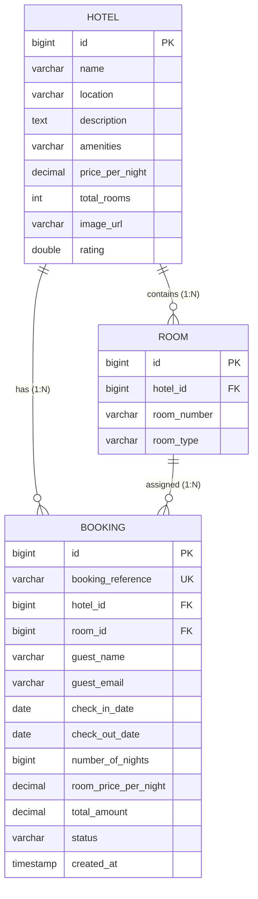

# System Design & Architecture Document: Aura Stays Portal

This document outlines the architectural decisions, database modeling, business algorithms, concurrency mitigation, and trade-offs made in the implementation of the **Aura Stays Hotel Booking Portal**.

---

## 1. System Architecture

The application adopts a **Layered Monolithic Architecture** with a decoupled single-page application (SPA) client:

```
[ React 18 + Vite SPA Client (Port 5173) ]
                   │
                   ▼  (REST / JSON via HTTP)
      [ Web & CORS Layer (WebMvcConfigurer) ]
                   │
                   ▼
     [ Controller Layer (@RestController) ]
                   │
                   ▼
     [ Service Layer (@Service, @Transactional) ]
                   │
                   ▼
     [ Repository Layer (Spring Data JPA) ]
                   │
                   ▼
   [ Database (MySQL 8+ / H2 In-Memory) ]
```

### Layer Responsibilities
- **Controller Layer (`controller`)**: Validates incoming HTTP payloads via `@Valid`, delegates execution to services, and packages results in uniform `ApiResponse<T>` or `ErrorResponse` objects. Contains zero business calculations.
- **Service Layer (`service`)**: Contains all core domain logic: date validation, server-side price calculation, room availability counting, booking reference generation, and cancellation transitions.
- **Repository Layer (`repository`)**: Spring Data JPA interfaces defining queries and custom JPQL calculations.
- **Entity Layer (`entity`)**: JPA entities representing physical tables (`hotels`, `rooms`, `bookings`).
- **DTO Layer (`dto`)**: Strongly-typed data contracts separating internal persistence models from external API contracts.
- **Exception Layer (`exception`)**: Centralized `@RestControllerAdvice` mapping domain exceptions to HTTP status codes (`400`, `404`, `409`, `500`).

---

## 2. Database Design & Relationships

### Entity Relationship Diagram (ERD)



### Constraints & Indexes
- **`booking_reference`**: `UNIQUE`, indexed for fast $O(1)$ lookups.
- **`hotels.location`**: Indexed for fast case-insensitive location searches.
- **Composite Index `(hotel_id, check_in_date, check_out_date, status)`**: Optimizes the overlapping availability queries during high-traffic browsing.

---

## 3. API Design

### REST Principles & Status Codes
- **`GET /api/hotels`**: `200 OK` — Fetch hotel listings.
- **`GET /api/hotels/{id}`**: `200 OK` (or `404 Not Found` if nonexistent).
- **`GET /api/hotels/{id}/calculate-price`**: `200 OK` — Server-side calculation preview.
- **`POST /api/bookings`**: `201 Created` — Successful reservation creation.
- **`POST /api/bookings/retrieve`**: `200 OK` — Lookup by reference and email.
- **`POST /api/bookings/{reference}/cancel`**: `200 OK` — Cancel reservation and free capacity.

### Consistent JSON Contract
```json
{
  "success": true,
  "message": "Operation description",
  "data": { ... },
  "timestamp": "2026-11-13T18:30:00"
}
```

---

## 4. Core Booking & Availability Logic

### A. Server-Side Price Calculation
The client is strictly prohibited from dictating the booking amount. The server computes:
$$\text{numberOfNights} = \text{ChronoUnit.DAYS.between}(\text{checkInDate}, \text{checkOutDate})$$
$$\text{totalAmount} = \text{pricePerNight} \times \text{numberOfNights}$$
Using `java.math.BigDecimal` ensures high arithmetic precision without floating-point rounding errors.

### B. Date Range Validation Rules
1. $\text{checkInDate} \ge \text{LocalDate.now()}$ (Past check-in rejected).
2. $\text{checkOutDate} > \text{checkInDate}$ (Same-day check-in/out or reverse dates rejected).

### C. Overlapping Booking Mathematical Formulation
Two date ranges $[\text{checkIn}_A, \text{checkOut}_A)$ and $[\text{checkIn}_B, \text{checkOut}_B)$ overlap if and only if:
$$\text{existing.checkInDate} < \text{requested.checkOutDate} \quad \text{AND} \quad \text{existing.checkOutDate} > \text{requested.checkInDate}$$

In JPQL (`BookingRepository.java`):
```sql
SELECT COUNT(b) FROM Booking b 
WHERE b.hotel.id = :hotelId 
  AND b.status = 'CONFIRMED'
  AND b.checkInDate < :checkOutDate 
  AND b.checkOutDate > :checkInDate
```
**Availability formula:**
$$\text{availableRooms} = \max\left(0, \; \text{hotel.totalRooms} - \text{activeOverlappingBookings}\right)$$

### D. Releasing Capacity on Cancellation
When a booking is cancelled:
1. `booking.setStatus(BookingStatus.CANCELLED)` is persisted.
2. Because the availability query explicitly filters by `status = 'CONFIRMED'`, the cancelled booking is instantly excluded from overlapping counts, returning the room to the inventory pool without requiring batch re-indexing.

---

## 5. Key Design Decisions

1. **Explicit Java Getters/Setters vs. Lombok**:
   - *Decision*: Written in pure standard Java without Lombok.
   - *Rationale*: Eliminates annotation processor build dependencies and IDE plugin issues, while allowing freshers to explain every method in an interview without hidden bytecode magic.
2. **Dual Database Configuration (H2 + MySQL)**:
   - *Decision*: MySQL is configured in `application-mysql.properties`, but in-memory H2 is active by default.
   - *Rationale*: Allows anyone evaluating the project to clone and run immediately in 1 step without configuring MySQL credentials, while retaining full production-grade MySQL compatibility.
3. **Pure CSS Design System vs. Heavy UI Libraries**:
   - *Decision*: Crafted clean modern CSS using CSS variables and flexbox/grid.
   - *Rationale*: Strictly adheres to the **"NO BLUE"** warm beige/charcoal design requirement with zero bundle bloat and zero third-party component conflicts.

---

## 6. Simultaneous Booking (Concurrency) Handling

In a multi-user environment, two guests might attempt to book the last remaining room at the exact same instant.

### Current Mitigation:
1. **`@Transactional` Isolation**: The availability check, room lookup, and booking insert occur within a single database transaction.
2. **Double-Checked Capacity**: Room availability is re-evaluated immediately before entity persistence.

### Production Scaling Improvements:
- **Pessimistic Locking**: Execute `SELECT ... FOR UPDATE` on the `Hotel` or physical `Room` record to block concurrent writers until the active transaction commits.
- **Optimistic Locking**: Add an `@Version` column to the `Hotel` entity. If two transactions read version $N$, the first to commit increments to $N+1$, and the second receives an `OptimisticLockException` which the service catches to return a friendly `RoomUnavailableException`.

---

## 7. Surprise Feature: "Smart Stay Recommendation"

### Goal
Provide a transparent "best-value" recommendation without AI models or external API calls.

### Algorithm
1. Filter hotels by location (if specified).
2. Filter out all hotels with $\text{availableRooms} \le 0$ for the requested dates.
3. Compute the **Value Score**:
   $$\text{Value Score} = \frac{(\text{Amenities Count} \times 15.0) + (\text{Guest Rating} \times 10.0)}{\text{Price Per Night}} \times 100$$
4. The candidate with the maximum score is awarded the **"Smart Stay: Best Value Pick"** badge, along with an English explanation reason detailing why it is the best deal.

---

## 8. Limitations & Future Roadmap

1. **Authentication & User Profiles**: Currently, guests book directly using name and email. Adding JWT / Spring Security would allow returning guests to view all historical bookings in a personal dashboard.
2. **Dynamic Pricing**: Currently rates are static per night; future iterations could implement seasonal or weekend rate multipliers.
3. **Automated Email Service**: Integrate JavaMailSender / SendGrid to dispatch PDF booking confirmation vouchers upon booking.
